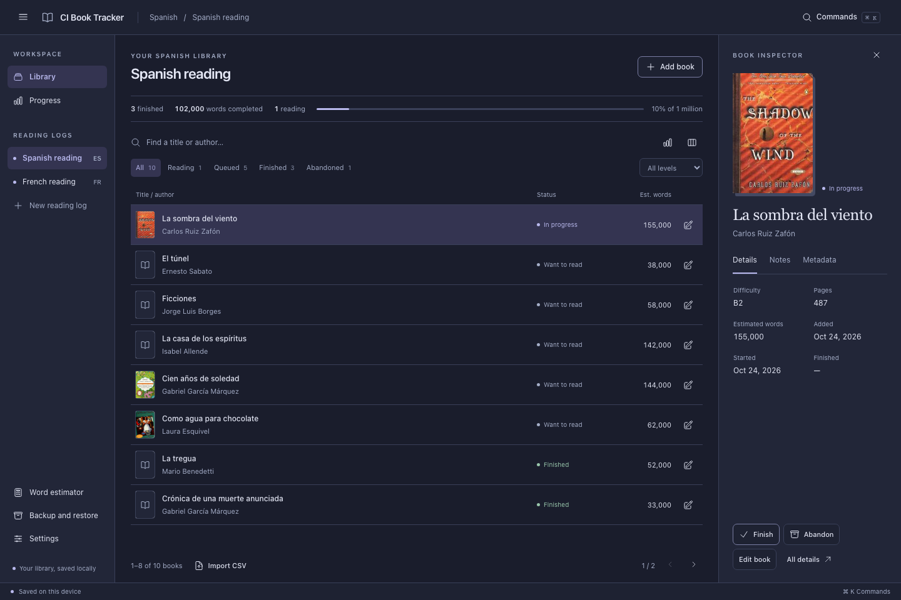
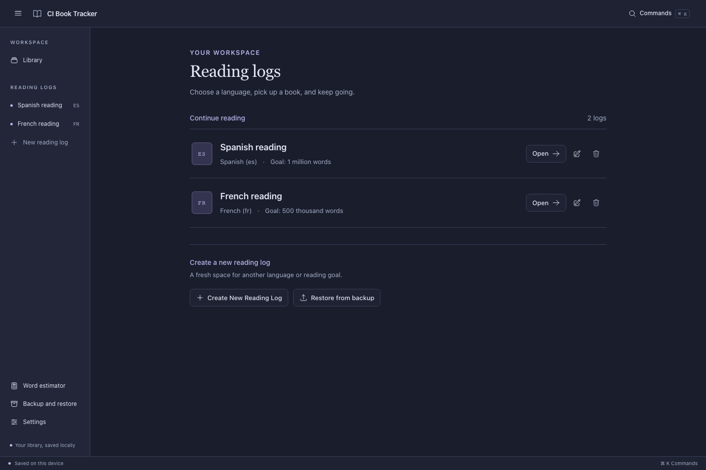
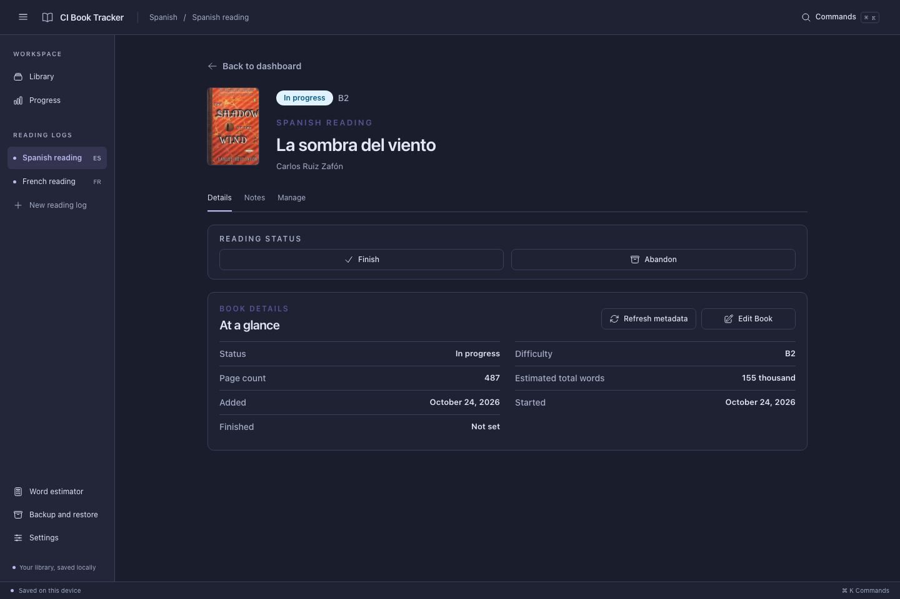
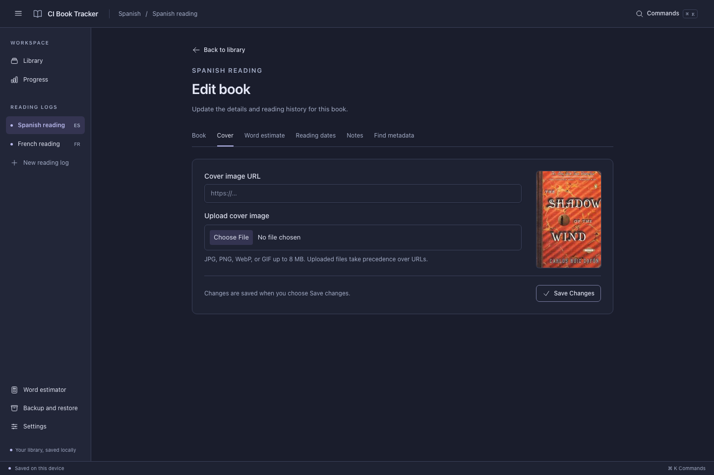
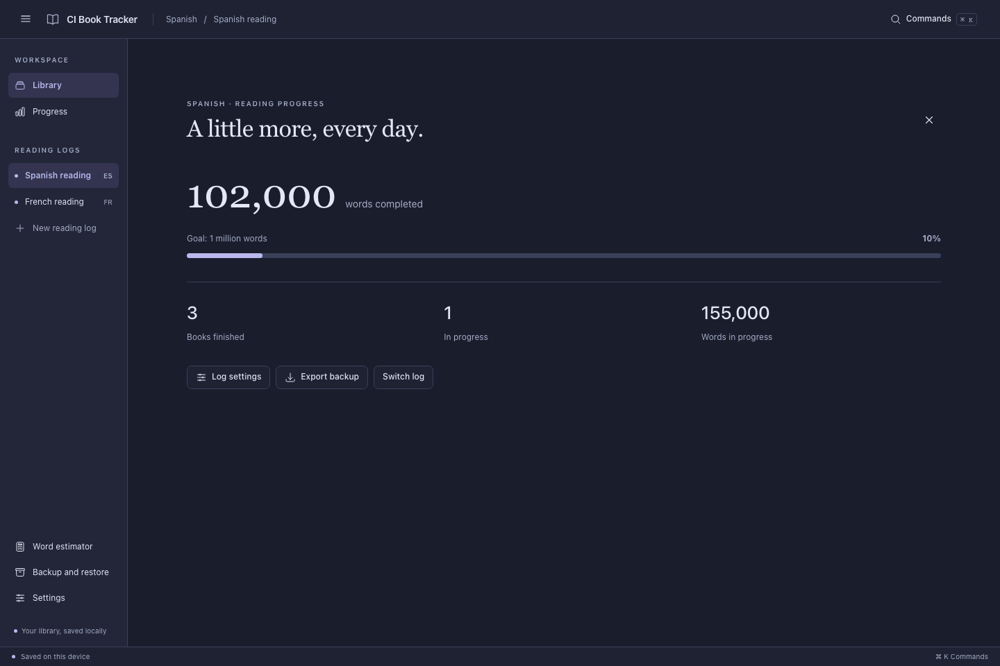
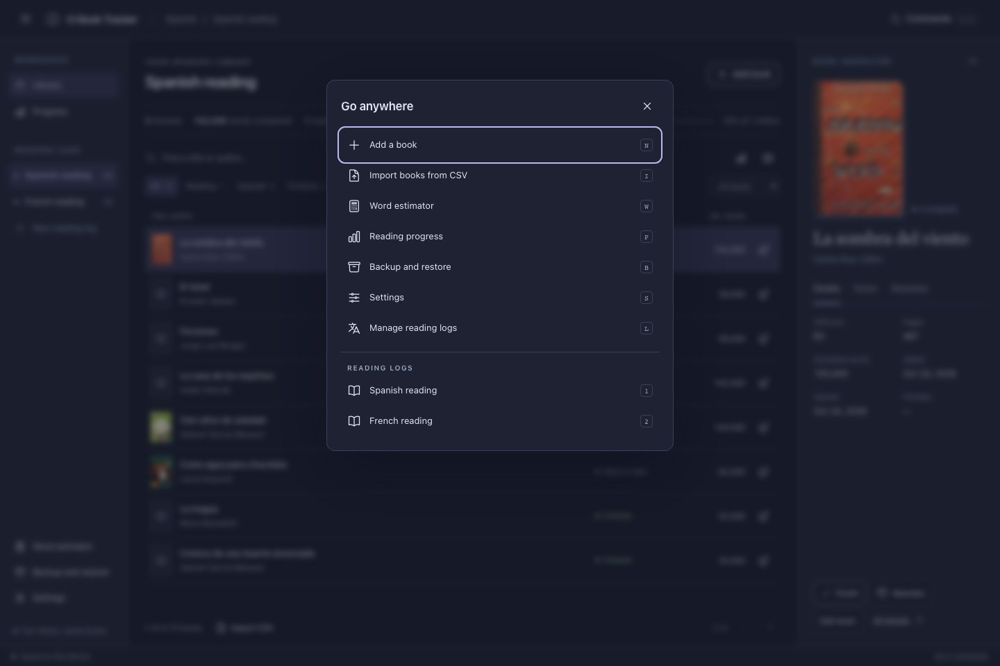

# CI Book Tracker

CI Book Tracker is a local-first reading tracker for language learners. It
organizes books into language-specific reading logs, tracks reading goals and
estimated words read, and keeps the data in a local SQLite database.

Manual entry and local cover uploads work fully offline. Internet access is
only needed for optional metadata lookups and downloading cover images from
URLs.

## Screenshots

### Workbench and book inspector



### Reading logs



### Book details



### Cover editor



### Reading progress



### Command menu



## Why This Project Exists

Reading a large amount of understandable, interesting material can be a useful
part of learning a language. CI Book Tracker provides a simple way to keep a
personal record of that work without requiring an account or cloud service.

The application helps readers:

- Record books they want to read, are reading, or have completed
- Estimate the number of words they have read
- Set long-term reading goals for each language
- Review their progress over time
- Keep their reading history in a portable, user-owned database

## Extensive Reading and Comprehensible Input

Extensive reading generally means reading large quantities of relatively easy
and interesting material for meaning and enjoyment, rather than stopping to
study every unfamiliar detail. Many language learners use extensive reading as
one part of a comprehensible input approach to language acquisition.

These ideas inspired the project, but the application is simply a tracking
tool; it does not attempt to prove a particular theory of language learning.

Further background:

- [What is Extensive Reading?](https://erfoundation.org/wordpress/what_is/)
- [Project inspiration video](https://www.youtube.com/watch?v=OheGJ2geFnA)

## Features

- Compact Workbench with collapsible navigation, book covers, and a book inspector
- Multiple language-specific reading logs
- Editable reading goals and estimated words-read totals
- Add, edit, view, and delete books
- Book status workflow:
  - Want to Read
  - In Progress
  - Finished
  - Abandoned
- Search and filtering within a reading log
- Optional metadata lookup and metadata refresh
- Optional cover lookup, URL download, and local image upload
- Bulk book import from CSV
- Standalone and book-form sample-based word count estimator
- Local SQLite storage
- Portable ZIP backup and restore, including locally stored covers
- Settings page with metadata provider configuration

## Metadata Providers

CI Book Tracker can search these optional providers:

- [Open Library](https://openlibrary.org/)
- [Google Books](https://books.google.com/)
- [Hardcover](https://hardcover.app/)

Open Library can be used without configuration. Google Books and Hardcover can
use credentials configured on the Settings page or through environment
variables. Availability and result quality depend on the provider.

Metadata lookup is an enhancement, not a requirement. Books can always be
entered and edited manually, and the rest of the application remains useful
without internet access.

## Word Count Estimator

The sidebar and command menu link to a standalone word count estimator that does not
require an active reading log. Paste a representative passage, enter how many
pages, Kindle locations, screens, chapters, or percentage points it covers,
and provide the corresponding total for the book.

The estimator counts the sample and scales it to an estimated total. Sample
text and results are not saved. The same estimator is available while adding
or editing a book, where its result can be applied directly to the book form.

## Philosophy

- Local-first and offline-capable
- No accounts
- No cloud dependency
- User-owned data
- Portable SQLite storage
- Manual entry as a first-class workflow
- Metadata as an optional convenience

See [`docs/prompts/00_philosophy.md`](docs/prompts/00_philosophy.md) for the
original project philosophy.

## Workbench

The Slate and Iris interface keeps the library, book covers, and selected book's
details together in one workspace. Collapse the navigation or book inspector to
make more room, filter the library, or open Progress to review a reading goal.
Book editing and settings use tabs to keep related controls together.

Press Command-K (Control-K on other platforms) to open the command menu. While
the menu is open, use the displayed shortcuts:

| Key | Command |
| --- | --- |
| N | Add a book |
| I | Import books from CSV |
| W | Word estimator |
| P | Reading progress |
| B | Backup and restore |
| S | Settings |
| L | Manage reading logs |
| 1–9 | Open the reading log shown beside that number |

In the library, `/` focuses book search and the arrow keys or J/K move between
books when you are not typing into a field. Escape closes the book inspector.
Routine success messages stay out of the way; errors appear inline.

## Backup and restore

Open **Backup and restore** from the sidebar or command menu. Choose **Export
backup** to download a ZIP containing the SQLite database and local cover
images. Settings → **Local data** also offers an export button.

To restore, choose **Restore backup** → **Choose a backup**, or **Restore from
backup** on the reading-log selection page. Select a ZIP backup or a legacy
`.db`, `.sqlite`, or `.sqlite3` file. After the app checks the file, choose
**Restore backup** and review the replacement confirmation if prompted.
Restart CI Book Tracker when restoration finishes.

Both the backup file and its expanded contents must fit within the same 250 MB
limit. Export and restore explain when a backup exceeds that limit.

Before restoring, the app saves the current database and covers to a timestamped
ZIP in the `backups` folder beside the active database. The restore page shows
the actual folder path. If that automatic backup fails, restoration stops before
replacing the current data. A ZIP restore replaces the database and local
covers; a legacy SQLite restore replaces only the database.

Backups from earlier known migration versions are upgraded in a temporary copy
before restoration. The original backup and live database stay unchanged during
validation. Backups from newer versions or with incomplete migration histories
are rejected. Failed upgrades never replace current data.

Keep regular backup ZIPs somewhere separate from the device running the
application. Backups include provider settings and any credentials saved in
those settings, so store them privately.

## Native Packages and Homebrew

Native release packaging targets Apple Silicon macOS, Intel macOS, and x86-64
Linux using standard Phoenix releases with bundled Erlang/Elixir. The release
launcher starts the local web app, creates its session secret, and applies
database migrations automatically. No developer toolchain is needed to run a
package.

See [distribution instructions](docs/distribution.md) for building packages,
platform requirements, configuration, and publishing the Homebrew tap.

Install and start the application:

```sh
brew install wasichu/tap/ci-book-tracker
ci-book-tracker
```

Open [http://localhost:4000](http://localhost:4000). Stop with Ctrl-C. Packages
target macOS 15+ on Apple Silicon and Intel, and Ubuntu 24.04 or compatible
x86-64 Linux systems. See the distribution instructions for system libraries
required by the Linux package. Prebuilt archives are also available on the
[GitHub releases page](https://github.com/wasichu/ci-book-tracker/releases).

If port 4000 is in use, choose another port:

```sh
PORT=4100 ci-book-tracker
```

Then open [http://localhost:4100](http://localhost:4100). To upgrade, stop the
running app, run `brew update` and `brew upgrade ci-book-tracker`, then start it
again. Your database and covers remain in the application data directory.

## Development

Requirements:

- Elixir 1.20.4 or a later 1.20 patch
- Erlang/OTP 29 (the tested versions are pinned in `.tool-versions`)
- SQLite development support required by `exqlite`
- Standard build tools for compiling dependencies

The repository's `.tool-versions` pins the recommended Elixir and Erlang/OTP
versions for `mise` or `asdf`. After installing either version manager, run its
install command from the project directory before running Mix tasks.

Phoenix 1.8 and LiveView 1.2 are installed as project dependencies.
Install dependencies, prepare the database, and build the assets:

```sh
mix setup
```

Start the application:

```sh
mix phx.server
```

Visit [http://localhost:4000](http://localhost:4000). Use
`PORT=4100 mix phx.server` to select a different port. To run the server inside
IEx instead:

```sh
iex -S mix phx.server
```

Run the test suite:

```sh
mix test
```

Run the complete project check before committing:

```sh
mix precommit
```

GitHub Actions runs `mix ci` to check formatting without rewriting files,
compile with warnings treated as errors, run tests, and build assets using the
pinned toolchain. A separate job runs `mix hex.audit` for dependency advisories.

Dependabot checks Elixir dependencies and GitHub Actions every Monday at 09:00
America/Chicago. Minor and patch updates are grouped by ecosystem; major
updates arrive separately. Updates open pull requests for review and run the
normal CI checks (including native package builds for application changes).
Merging stays manual. CI also runs weekly while the repository is idle to
catch new dependency advisories and regressions. The Elixir/OTP toolchain pins
in `.tool-versions` and asset-tool versions in `config/config.exs` still need
manual maintenance.

For a maintainer-oriented overview of the domain, LiveViews, persistence,
metadata normalization, backup workflows, and final refactor decisions, see
[`docs/architecture.md`](docs/architecture.md).

## Data storage

Reading logs, books, provider settings, and other application data are stored
in a local `reading_log.db` SQLite database:

| Platform | Default directory |
| --- | --- |
| Linux | `~/.local/share/reading_log/` |
| macOS | `~/Library/Application Support/reading_log/` |
| Windows | `%APPDATA%/reading_log/` |

Locally stored book covers are kept in the `covers/` directory within the
application data directory. Covers selected from metadata providers or entered as image
URLs are downloaded there when the book is saved. JPG, PNG, WebP, and GIF
files can also be uploaded directly.

Set `DATABASE_PATH` to use a different location:

```sh
DATABASE_PATH=/absolute/path/to/reading_log.db mix phx.server
```

`DATABASE_PATH` changes only the database location; covers stay in the
application data directory. For a packaged installation, set
`CI_BOOK_TRACKER_DATA_DIR` to choose the directory for the default database,
covers, and generated session secret:

```sh
CI_BOOK_TRACKER_DATA_DIR=/absolute/path/to/reading-data ci-book-tracker
```

These variables select storage locations; they do not copy existing data. Use
a backup and restore to transfer an existing library.

Settings → **Local data** shows the active database path. Settings → **About**
shows the application and SQLite versions. See
[Backup and restore](#backup-and-restore) for moving or recovering your library.

After pulling a version that adds a database migration, apply it before
starting the server:

```sh
mix ecto.migrate
```

Existing books that have a remote cover URL but no downloaded local image can
be backfilled once:

```sh
mix book_covers.backfill
```

## Provider Configuration

Provider credentials can be entered on the Settings page. They can also be
provided at startup:

| Variable | Purpose |
| --- | --- |
| `GOOGLE_BOOKS_API_KEY` | Optional Google Books API key |
| `HARDCOVER_API_TOKEN` | Optional Hardcover bearer token |

Google Books may allow requests without a key, but unauthenticated quota is not
guaranteed. Hardcover remains disabled until a token is configured.

## Deployment Scope

Packaged releases bind to `127.0.0.1` by default. The development server is
configured to listen on all interfaces; run it only on a trusted network.
CI Book Tracker has no authentication or multi-user isolation. It is
intended to run as a personal application on a trusted device or network. Do
not expose it to an untrusted network without adding suitable authentication
and authorization.

## License

This project is licensed under the MIT License. See [LICENSE](LICENSE) for the
full text.
